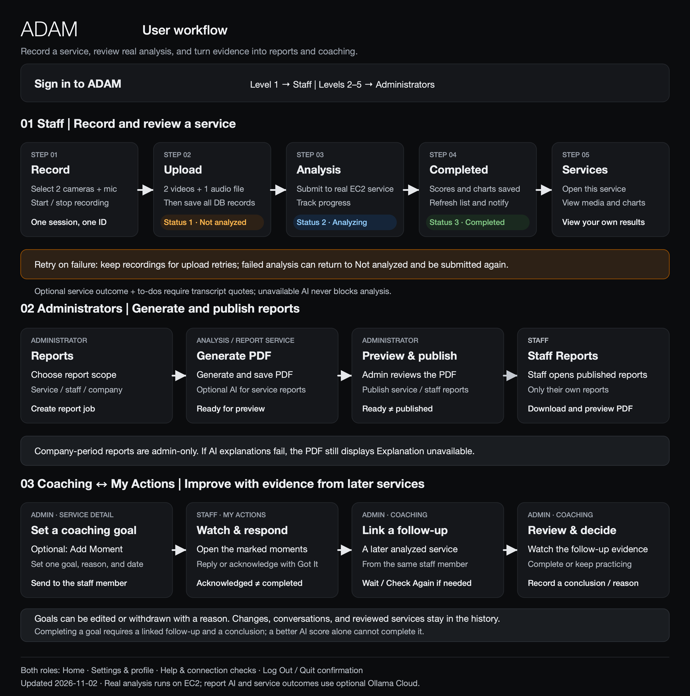

# ADAM — Multimodal Service Satisfaction Analysis

A desktop application for recording service interactions and reviewing customer and staff performance through video, audio, and text analysis.

Built with **Python 3.13, PySide6, and QML**, ADAM provides separate staff and administrator interfaces for recording, analysis, dashboards, and PDF reports. The primary development platform is **macOS**, and the application interface is in English.

> **Repository scope:** The version-controlled application is the desktop client. A complete installation also needs MySQL, S3, and an analysis/report API. This local checkout contains analyzer implementations under ignored directories; those implementations and the production database setup are not included in a fresh Git clone.

[Features](#features) · [Architecture](#architecture) · [Workflow](#workflow) · [Getting started](#getting-started) · [Configuration](#configuration) · [Tests and CI](#tests-and-ci) · [Project structure](#project-structure) · [Current limitations](#current-limitations)

## Features

| Feature | Staff | Administrators |
| --- | --- | --- |
| Home | Personal scores, service counts, trends, and recent performance | Organization-wide scores, service counts, trends, and staff ranking |
| Record | Record two cameras and one microphone; upload recordings | — |
| Analysis | Submit analysis, track progress, retry failures, and receive completion notifications | — |
| Services | Search personal service records; play media and inspect charts | Search service records across staff; play media and inspect charts |
| Coaching | Respond to goals and acknowledge them in My Actions | Add time markers and goals; review later services and complete, adjust, or withdraw goals |
| Reports | Read service and period reports published for the signed-in staff member | Generate service, staff-period, and company-period PDFs; preview and publish eligible reports |
| Add Account | — | Create and manage accounts within the current permission level |
| Settings | Profile, photo, password, preferences, notifications, and recording devices | Profile, photo, password, and preferences |
| Help and storage | Connection checks, diagnostic summaries, local folders, and download-cache cleanup | Same |

Account level `1` opens the staff interface; levels `2–5` open the administrator interface. Account-management actions cannot exceed the signed-in administrator’s level. Company-period reports remain administrator-only.

## Architecture


The desktop client accesses MySQL and S3 directly and calls an HTTP API to request analysis and PDF generation. AWS deployments use **Amazon RDS for MySQL 8.4**, **Amazon S3**, and an analysis/report service on **Amazon EC2**. Local development can use MySQL, moto, and a test API.

| Component | Responsibility |
| --- | --- |
| PySide6 / QML | Sign-in, role-specific pages, dashboards, recording controls, media playback, and report previews |
| OpenCV / PyAudio | Capture customer video, staff video, and microphone audio |
| TaskRunner / DbLane | Run database, network, and PDF work in the background; return results to the UI thread |
| MySQL 8.4 | Accounts, service states, scores, file locations, and report publication records |
| S3 / boto3 | Upload and download recordings, charts, transcripts, report data, PDFs, and profile photos |
| Analysis/report API | Process recordings, write analysis results, and generate PDFs |
| Ollama Cloud (optional) | Generate service-report explanations, service outcomes, and to-dos from existing scores and translated transcripts |

### Real analyzer and test service

There are two distinct service implementations in this local checkout:

| Implementation | Local path | Behavior |
| --- | --- | --- |
| AWS-adapted real analyzer | `docs/rebuild/analyzer/` | Runs the full video, audio, and text pipeline on the EC2 CPU (Whisper, pyannote, Wav2Vec2, DeepFace); generates scores, charts, transcripts, and report data |
| Placeholder test service | `docs/rebuild/analysis_service/` | Generates test scores, charts, and transcripts to exercise the application workflow |

The original analysis source is also present in `service_analyzer/`. These directories are excluded from Git. Their absence from a fresh clone does not mean that the real analysis code does not exist or cannot already be deployed.

**EC2 is the host; the deployed code determines which implementation runs.** The EC2 tutorial starts with the test service. Since 2026-11-02 the EC2 instance runs the real analyzer (`adam-analyzer:1`, Whisper `medium`), deployed with `docs/rebuild/real-analyze/DEPLOY.md` after an end-to-end run on that instance. Its `/healthz` reports `"models":"ready"`, which the test service does not; check it before relying on this, because local documentation alone does not establish which image is running.

### Real analysis pipeline


The real analyzer runs every model on the EC2 instance's CPU and calls no AWS AI service. Amazon Transcribe and Amazon Translate are listed only under the AWS Paid plan, so speech-to-text and translation also run locally:

- **Who spoke when:** pyannote 3.1 runs once per service. Its speaker turns feed both the transcript and the voice-emotion step, so both use the same staff/customer mapping (the speaker with more turns is staff).
- **Text:** faster-whisper (CTranslate2, int8) transcribes the Chinese speech; each word goes to the speaker turn it overlaps most; OpenCC converts the text to Taiwan Traditional Chinese, and opus-mt-zh-en translates each sentence to English for VADER. Sentences that pyannote did not hear (Whisper hallucinations in silence) are dropped.
- **Voice and face:** Wav2Vec2 scores voice emotion per speaker turn; DeepFace scores the customer (`cam0`) and staff (`cam1`) cameras once per second.
- **Results:** scores, five charts, the transcript, and report data are saved to RDS and S3. Reports draw the Audio, Text, and Facial charts from the report data; Ollama Cloud optionally adds explanations and the service outcome.

Models are downloaded once into `/opt/adam/models` (the gated pyannote models need a Hugging Face token for that one download) and loaded offline afterwards. On the EC2 instance (m7i-flex.large: 2 vCPU, 8 GiB), the whole service analyses a 1-minute two-person conversation in about 3 minutes with the default `medium` Whisper model (1.7% character error rate on the test dialogue, every word attributed to the right speaker) and peaks at about 5 GiB of memory. `WHISPER_MODEL` selects `small`, `medium`, or `large-v3-turbo`. A local end-to-end test with real models, the Whisper size comparison, and the EC2 deployment steps are in `docs/rebuild/analyzer/e2e/` and `docs/rebuild/real-analyze/`.

### Report explanations

Analysis scores and AI-written explanations are separate stages. The current report-service implementation uses **Ollama Cloud** to explain existing analysis results. Amazon Bedrock is not connected to the current runtime. If explanations are disabled or unavailable, PDF generation continues and the affected fields display `Explanation unavailable`.

### File storage

```text
S3 bucket
├── video/        Customer and staff videos
├── audio/        Microphone recordings
├── charts/       Analysis charts
├── text/         Transcripts
├── report-data/  Structured analysis data for reports
├── reports/      Generated PDF reports
└── avatars/      Profile photos
```

File locations use `s3://<bucket>/<key>` URLs or the corresponding object keys. The client downloads files into a local cache for playback and preview, so the bucket can remain private.

## Workflow



### Staff

1. Sign in and confirm the customer camera, staff camera, and microphone in **Settings → Devices** or the recording page.
2. Open **Record**, start a session, and stop recording. Each session has one `service_id` shared by two video files and one audio file.
3. Wait for upload. All three uploads must succeed before the service and file records are saved in one database transaction. Failed uploads retain the local recordings for retry.
4. Submit the service from **Analysis**. The application tracks its status and can notify you when analysis finishes.
5. Open the service in **Services** to review scores, charts, and media. Read reports published for you in **Reports**.

```text
Recordings saved       API accepts the job       Results saved
       |                       |                      |
       v                       v                      v
  1 Not analyzed ───────> 2 Analyzing ───────────> 3 Completed
       ^                       |
       └──── Failed; retry ─────┘
```

The client uses a conditional status update to avoid overwriting a completed service (`3`) with analyzing (`2`). A failed backend job can return status `2` to `1`, allowing another submission.

### Administrators

1. Review overall trends and rankings in **Home**, and inspect staff service records in **Services**.
2. Use **Reports** to request a service, staff-period, or company-period PDF.
3. Preview the completed report. Service and staff-period reports appear in the relevant staff member’s Reports only after **Publish**. Company-period reports remain administrator-only.
4. Manage accounts in **Add Account**. Both roles can use **Log Out** to return to sign-in or **Quit** to close the application.

Report generation and publication are separate states. Failed generation can be retried; regeneration creates a new report record and preserves the history.

## Getting started

Run the following commands yourself when setting up the project. Unless stated otherwise, Python and Briefcase commands run inside `myapp/`.

### 1. Prepare the environment

| Requirement | Details |
| --- | --- |
| Operating system | macOS; the current uv lock targets Darwin |
| Python | 3.13, managed by uv |
| Package manager | uv |
| Native audio dependency | PortAudio; the first PyAudio installation requires local build tools |
| Recording hardware | Two available cameras and an input microphone, with macOS permissions granted |
| Supporting services | Initialized MySQL, an accessible S3 bucket, and an analysis/report API |

With Homebrew:

```bash
brew install uv portaudio
```

From the repository root:

```bash
cd myapp
uv python install 3.13
uv sync
```

Dependencies are declared in [pyproject.toml](myapp/pyproject.toml) and pinned in [uv.lock](myapp/uv.lock).

If PyAudio compilation or linking fails, check PortAudio and the Command Line Tools installation. If Xcode selects an incompatible beta SDK, point `SDKROOT` to an installed, compatible stable macOS SDK before running `uv sync`.

### 2. Configure the services

Create `.env` in the repository root or `myapp/`. This AWS example requires replacing every `<...>` placeholder:

```dotenv
DB_HOST=<rds-endpoint>
DB_PORT=3306
DB_NAME=adam
DB_USER=adam_app
DB_PASSWORD=<database-password>
DB_SSL_CA=/absolute/path/to/global-bundle.pem

AWS_REGION=us-east-1
AWS_PROFILE=adam-dev
S3_BUCKET=<your-private-bucket>

ANALYZE_API_URL=https://<analysis-host>/analyze
# Set this only when the report API uses a different location.
# REPORTS_API_URL=https://<reports-host>/reports
```

`AWS_PROFILE` must refer to a configured, valid local AWS profile. boto3 also supports its standard credential sources; EC2 services can use an IAM role. Database users, AWS identities, and ADAM login accounts are separate.

The database must contain the matching tables, stored procedures, and grants. Existing databases also need the updates for profile photos, reports, and self-service account settings. Apply the appropriate migrations rather than rerunning initialization SQL over existing data. Sign in with an ADAM account already created in that database.

### 3. Launch the desktop application

```bash
uv run briefcase dev
```

After changing dependencies, refresh the Briefcase environment:

```bash
uv run briefcase dev -r
```

**Launch through Briefcase.** The application relies on metadata provided by Briefcase; `python -m myapp` is not the supported entry point. The sign-in screen can load without AWS credentials, but authentication needs MySQL, and upload and review features need their supporting services.

## Configuration

| Variable | Purpose | Default / notes |
| --- | --- | --- |
| `DB_HOST`, `DB_NAME`, `DB_USER`, `DB_PASSWORD` | MySQL connection | Environment-specific; database-name case must match the server |
| `DB_PORT` | MySQL port | `3306` |
| `DB_SSL_CA` | MySQL TLS CA certificate path | Enables certificate and hostname verification; configure for RDS |
| `AWS_REGION` | AWS Region | This project’s AWS setup uses `us-east-1` |
| `AWS_PROFILE` | Local AWS profile | Optional; otherwise boto3 uses its standard credential sources |
| `S3_BUCKET` | Media and report bucket | Required for upload/download features |
| `AWS_ENDPOINT_URL` | Custom AWS SDK endpoint | Used for local moto; remove when connecting to AWS |
| `ANALYZE_API_URL` | Full `/analyze` endpoint | Receives `{"service_id": "..."}` |
| `REPORTS_API_URL` | Full `/reports` endpoint | Optional; otherwise derived from the analysis URL |
| `LOCAL_MEDIA_DIR`, `LOCAL_CHARTS_DIR` | Download-cache locations | Default to `media/` and `charts/` under `src/myapp/init/` |

### Local development and AWS

| Service | Local development example | AWS deployment |
| --- | --- | --- |
| Database | MySQL 8.4 at `127.0.0.1:3306` | RDS for MySQL 8.4 |
| Files | moto at `http://127.0.0.1:5055` | S3 bucket |
| Analysis API | Test service at `http://127.0.0.1:5056/analyze` | Separately deployed API on EC2 |

When `AWS_ENDPOINT_URL` points to moto, uploads go to the local emulator. Switching to AWS requires the appropriate credentials, bucket, database, and API settings; changing the Region alone is insufficient. Connecting to real S3 and RDS also does not determine whether the API generates real or placeholder analysis.

### Recordings and caches

Recordings use relative paths and are normally saved to `~/video/` and `~/audio/` when launched through `briefcase dev`. Downloaded media, charts, PDFs, and photos use separate caches. **Clear Download Cache** in Settings removes files that can be downloaded again and preserves original recordings.

### Backend-only AI configuration

The analysis/report service reads `OLLAMA_BASE_URL`, `OLLAMA_API_KEY`, `OLLAMA_MODEL`, and timeout settings. Keep the API key in backend configuration, outside the desktop client and version control. When enabled, scores, statistics, and translated transcript text are sent to the external model.

## Tests and CI

[myapp/tests](myapp/tests) uses pytest, moto, Qt offscreen, and disposable MySQL 8.4 instances. Tests do not load the normal development `.env`.

```bash
# Unit tests; Docker is not required.
uv run pytest -m "not integration"

# Unit and integration tests.
uv run pytest

# Include branch coverage; the configured threshold is 75%.
uv run pytest --cov
```

Local integration tests use Docker and a locally available `mysql:8.4` image by default. The version-controlled [test schema](myapp/tests/fixtures/schema.sql) contains database structure and synthetic accounts; update it when tables or stored procedures change. Missing Docker prerequisites skip integration tests unless `--require-integration` is supplied, which makes them fail instead.

See [GitHub Actions CI and deployment planning](.github/CI.md) for the macOS workflow. CI runs the full suite with disposable native MySQL 8.4 (`--mysql-backend=native`) and branch coverage, without AWS credentials. The document also covers future EC2 delivery, database migrations, and desktop releases.

## Project structure

```text
ADAM/
├── README.md
├── .github/                    GitHub Actions CI and deployment notes
├── assets/readme/              Diagrams: SVG sources and PNG previews
└── myapp/
    ├── LICENSE
    ├── pyproject.toml          Dependencies, Briefcase, and pytest
    ├── uv.lock
    ├── src/myapp/
    │   ├── main.py            Sign-in and QML engine startup
    │   ├── tasks.py           Background work and UI callbacks
    │   ├── db_lane.py         Serialized database work
    │   ├── database.py        MySQL configuration and connections
    │   ├── storage.py         S3 uploads and downloads
    │   ├── watcher.py         Analysis-status tracking
    │   ├── home_dashboard.py  Dashboard queries and statistics
    │   ├── service_list.py    Service lists
    │   ├── media.py           Media, charts, and PDF previews
    │   ├── reports.py         Report requests, lists, and publication
    │   ├── account.py         Profile settings and photos
    │   ├── ui_prefs.py        User preferences
    │   ├── diagnostics.py     Connection checks and diagnostics
    │   ├── init/              Role controllers, recording, and sessions
    │   ├── qml/               Pages, shared components, icons, and Theme
    │   └── images/            Sign-in artwork and attribution
    └── tests/
        ├── fixtures/          Test schema and synthetic data
        ├── unit/
        └── integration/
```

Additional directories available in this local checkout, but excluded from Git:

```text
docs/
├── AWS tutorial/              Service-specific AWS setup guides
└── rebuild/
    ├── analyzer/              AWS-adapted real analysis/report service
    ├── analysis_service/      Placeholder integration-test service
    ├── steps/                 Implementation and deployment instructions
    └── ...                    Plans, migrations, and design decisions
service_analyzer/              Original analysis source; contains legacy credentials
```

Do not publish embedded credentials from the original analysis source. The schema in `myapp/tests/fixtures/` is a test fixture, not a production migration.

## Current limitations

- **Backend delivery is separate.** Analyzer source exists locally but is not included in a fresh clone. Provision and deploy the chosen service separately. Confirm the active EC2 image when determining which implementation is running; placeholder outputs are test data.
- **macOS development is the primary target.** Windows, Linux, Briefcase build/package with the current uv setup, physical-device behavior, and packaged system-notification banners still need validation. In-app notifications and Dock reminders are implemented.
- **A full installation needs supporting services.** The desktop repository alone does not provision production database objects, S3 resources, or the analysis/report API.
- **Time settings must agree.** Recording timestamps use the desktop’s local time, while current period reports use `America/Los_Angeles`. Align desktop, backend, and database time settings.

## Contributing

Keep network, database, and PDF work off the UI thread, and deliver UI updates through Qt signals. Statistics must exclude `-1`, which represents missing score data.

Update both `pyproject.toml` and `uv.lock` when dependencies change. Preserve existing CRLF line endings in QML files, reuse shared components and Theme tokens, and wrap interface text in `qsTr()`. Run checks appropriate to your change and describe the impact and validation in the change summary.

## License

Application code is licensed under the [BSD 3-Clause License](myapp/LICENSE). See [asset sources and licenses](myapp/src/myapp/images/SOURCES.md) for artwork, font, and icon attribution.
